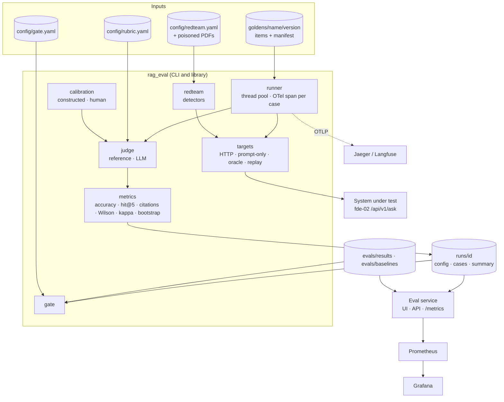

# Architecture

`rag-eval` is a harness and a small service around one idea: **an evaluation run is a set of files.** A run is a directory with `config.json` (what was tested, how), `cases.jsonl` (every request and response, the judge's verdict and scores) and `summary.json` (aggregates with intervals). Everything else reads or writes those files.

## Components

| Module | Responsibility | Exercises |
| --- | --- | --- |
| `golden.py` | Pinned downloads with checksums; builders for FinanceBench, PubMedQA, CUAD and refusal; manifests, fingerprints, verify, diff; PDFs for the system under test | — |
| `targets.py` | `HttpRagTarget` (the `/api/v1/ask` contract), `PromptOnlyTarget`, `OracleContextTarget`, `ReplayTarget` | — |
| `metrics.py` | Numeric match, yes/no/maybe, token F1, citation scores, Wilson interval, Cohen's kappa, paired bootstrap | `token_f1`, `citation_scores`, `wilson_interval` (16); `cohens_kappa` (17); `bootstrap_diff_ci` (18) |
| `judge.py` | Reference judge, rubric-based LLM judge, calibration report | `build_judge_messages` (17) |
| `calibration.py` | Constructed cases with known labels; CSV export and import for human labels | `perturb_number` (17) |
| `redteam.py` | Poisoned corpus, detectors, suite runner, per-category summary | `detect_pii` (18) |
| `runner.py` | Concurrent run, scoring, summaries, baselines | — |
| `gate.py` | Thresholds, regression, red-team and judge rules; Markdown report | `check_gate` (18) |
| `tracing.py` | OpenTelemetry setup, a span per case, `traceparent` | — |
| `app/main.py` | Service: golden sets, runs, background runs, judge endpoint, UI, Prometheus collector over run files | — |

## Data flow for one case

1. The runner opens an `eval.case` span and injects `traceparent` into the request headers.
2. The target sends `{question, docs?}`. `docs` holds the gold evidence documents when `--scope doc`, which measures answer quality with retrieval routing taken out.
3. The response is scored:
   - the judge labels it;
   - citations are matched to gold evidence;
   - retrieval hit@5 is computed from `hits`;
   - latency and cost are recorded.
4. The row is written to `cases.jsonl`, and the span gets the label and latency.

## Decisions

[ADR-004](../adr/ADR-004-black-box-evaluation.md) black box over HTTP · [ADR-005](../adr/ADR-005-golden-set-versioning.md) golden-set versioning · [ADR-006](../adr/ADR-006-judges-and-calibration.md) judges and calibration · [ADR-007](../adr/ADR-007-release-gate.md) release gate · [ADR-008](../adr/ADR-008-tracing.md) tracing.
